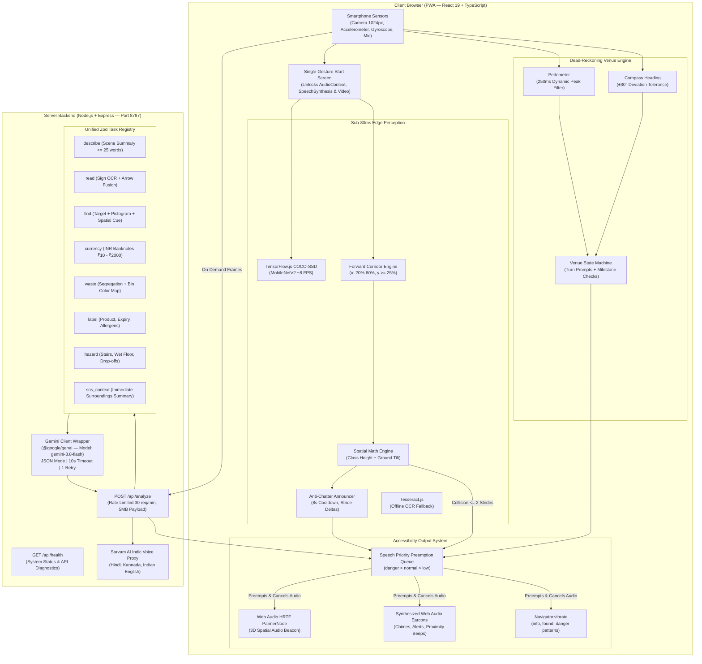

# AndhaDhun 👁️🔊
### *AI-Powered Environmental Awareness & Spatial Navigation for the Visually Impaired*

[](https://amcgroup.edu.in)
[](https://amcgroup.edu.in)
[](https://github.com/ani18cs/hack-attack)
[](https://www.typescriptlang.org/)
[](https://react.dev/)
[](https://www.tensorflow.org/js)
[](https://aistudio.google.com/)
[](https://developer.mozilla.org/en-US/docs/Web/API/Web_Audio_API)
[](https://www.w3.org/WAI/standards-guidelines/wcag/)

> **"AndhaDhun turns any commodity smartphone into an intuitive, voice-first spatial guide. In a world built for sighted eyes, AndhaDhun translates the physical environment into high-urgency haptics, synthesised earcons, HRTF 3D audio beacons, and concise directional speech — with zero custom hardware."**

---

## 🍀 Team CLOVER

Proudly built for **HackAttack 2026** at **AMC Engineering College (Autonomous), Bengaluru**  
**Track:** *Sustainability & Social Impact*

| Member | Role | Core Contributions | Primary Modules |
| :--- | :--- | :--- | :--- |
| **Aniket Kumar Singh** | **Team Lead & Full-Stack Architect** | System architecture, PWA shell, Speech Priority Preemption Queue, tactile UI (min 56px), haptic language, venue dead-reckoning engine & step calibrator. | `web/src/app/`, `web/src/components/`, `web/src/core/`, `web/src/venue/` |
| **Hrishita Shenvi** | **Vision & Spatial Intelligence Lead** | TensorFlow.js MobileNetV2 COCO-SSD pipeline, central walking corridor focus engine, ground-plane & bounding box trigonometry, anti-chatter deduplicator, HRTF 3D audio beacon. | `web/src/vision/detector.ts`, `spatial.ts`, `announcer.ts`, `spatialAudio.ts`, `modes/AroundMe.tsx`, `ObstacleAlert.tsx` |
| **Samiksha R Singi** | **AI, Server & Flagship Modes Lead** | Express server proxy, unified `POST /api/analyze` Zod task registry, Google Gemini 3.8 Flash multimodal prompt engineering, directional arrow fusion OCR, waste segregation, label reader. | `server/*`, `web/src/vision/api.ts`, `ocr.ts`, `modes/Read.tsx`, `modes/Find.tsx`, `docs/` |

---

## 📑 Table of Contents
1. [The Challenge & Social Impact](#-the-challenge--social-impact)
2. [What is AndhaDhun?](#-what-is-andhadhun)
3. [Key Innovations & Technical Pillars](#-key-innovations--technical-pillars)
4. [Complete Feature Matrix (10 Modes)](#-complete-feature-matrix-10-modes)
5. [System Architecture](#-system-architecture)
6. [Security, Secrets & Privacy Engineering](#-security-secrets--privacy-engineering)
7. [Accessibility & Human Interface Guidelines](#-accessibility--human-interface-guidelines)
8. [Quickstart & Local Setup](#-quickstart--local-setup)
9. [Mobile Live Testing (Zero-Setup HTTPS)](#-mobile-live-testing-zero-setup-https)
10. [Test Suite & Quality Verification](#-test-suite--quality-verification)
11. [4-Minute Judge Demo Script & Q&A](#-4-minute-judge-demo-script--qa)
12. [Honest Engineering Boundaries](#-honest-engineering-boundaries)
13. [Future Roadmap](#-future-roadmap)

---

## 🎯 The Challenge & Social Impact

Worldwide, over **285 million individuals are visually impaired**, with **39 million being completely blind**. In India alone, over 15 million people live with blindness.

### The Pain Points
- **Sensory Overload & Fear of Collisions:** Navigating unfamiliar indoor environments (hospitals, university campuses, transit terminals, supermarkets) causes severe psychological anxiety. White canes detect ground obstacles within 1 meter, but miss head-height overhangs, drop-offs, and dynamic hazards.
- **Prohibitive Hardware Costs:** Assistive smart glasses (e.g. Envision, eSight, OrCam) cost between **$1,500 and $5,000+** (₹1.2L – ₹4L). They are economically out of reach for 99% of visually impaired individuals in developing nations.
- **Indoor Blindness:** GPS is completely non-functional inside concrete buildings. Bluetooth Low Energy (BLE) beacon systems require tens of thousands of dollars in facility installation and ongoing battery maintenance.
- **Information Inaccessibility:** Signs indicating "EXIT ➡️" or "WASHROOM ⬅️" are useless without knowing **which way the arrow points**. Expiry dates on medicine containers are tiny, illegible, or folded.

### The AndhaDhun Solution
AndhaDhun eliminates the need for expensive custom hardware by turning the **smartphone already in the user's pocket** into a low-latency spatial perception companion. At an active cloud cost of **under ₹2 ($0.02) per day**, it delivers real-time obstacle avoidance, directional OCR with arrow fusion, 3D audio spatial beacons, and offline-capable indoor venue navigation.

---

## 👁️ What is AndhaDhun?

**AndhaDhun** (meaning *carefree, intuitive flow without sight*) is a Progressive Web App (PWA) operating on a single core sensory loop:

$$\text{See} \longrightarrow \text{Interpret} \longrightarrow \text{Speak \& Guide}$$

Instead of relying on visual screens, **Audio and Vibration are the primary interface**:
- **On-Device Edge Vision (<80ms):** Tracks obstacles in the direct walking corridor at ~8 FPS using TensorFlow.js COCO-SSD, calculating distance in human strides and triggering immediate preemption alerts.
- **Cloud Multimodal Vision (1–2s):** Calls Google Gemini 3.8 Flash via a unified backend proxy for high-level semantic reasoning (reading printed notices with directional arrows, inspecting Indian currency notes, categorizing municipal waste, verifying medicine packaging).
- **Audio Beacon Navigation:** Uses Web Audio HRTF 3D spatial panning so the user simply walks toward a sound centered between their ears.

---

## 💡 Key Innovations & Technical Pillars

### 1. 🚶 Forward Walking Corridor & Narrow Focus
Real-world camera views are cluttered with irrelevant background details (ceilings, lights, distant bystanders). AndhaDhun implements an intelligent focal corridor:
- **Central Corridor Gate:** Monitors the forward walking path ($x \in [0.20, 0.80]$, $y \ge 0.25$).
- **Ceiling Suppression ($y < 0.25$):** Lights, signs, and high ceilings are ignored for collision avoidance.
- **Peripheral Danger Policy ($x < 0.20$ or $x > 0.80$):** Peripheral objects are suppressed to prevent speech fatigue unless they present an imminent collision trajectory.

### 2. ⚡ Sub-80ms Danger Preemption Priority Queue
Audio collision is fatal for screenless interfaces. AndhaDhun enforces a 3-tier speech priority queue:
- **`danger`:** Preempts all ongoing speech synthesis and earcons within **<50ms**, activates rapid device vibration (`pulseDanger`), and speaks urgent collision warnings (*"Stop. Chair ahead."*).
- **`normal`:** Standard announcements (sign readings, scene summaries); automatically drops oldest items if queue size exceeds 3 to prevent backlog chatter.
- **`low`:** Ambient descriptions delivered only when the audio channel is completely idle.

### 3. 🎧 HRTF 3D Audio Spatial Beacon
In object-finding mode (*"Find bottle"*, *"Find washroom"*), the app dynamically instantiates a Web Audio `PannerNode` using **Head-Related Transfer Function (HRTF)** simulation:
- If the object is $45^\circ$ to the right, the beacon pings exclusively in the right ear.
- As the user turns toward the object, the sound smoothly centers across both stereo channels.
- Pinging frequency accelerates as the user approaches, providing an effortless sensory target to walk toward.

### 4. 🔀 Directional Arrow Fusion OCR
Standard OCR engines only return raw text (e.g. *"Emergency Exit"*). For a visually impaired traveler, this is incomplete. AndhaDhun's custom Gemini vision prompt fuses detected text with adjacent directional glyphs:
> *"Exit, arrow points right."*  
> *"Washroom, arrow points left."*

### 5. 🗺️ Offline Venue Navigation (Zero Hardware Beacons)
Navigating a college or clinic does not require $10,000 BLE beacons. AndhaDhun uses declarative JSON venue maps (`web/public/venues/amc-hackattack.json`) combined with:
- **Pedometer:** Peak-detection accelerometer filter with a 250ms dynamic gait threshold.
- **Compass:** Heading tracker with $\pm 30^\circ$ magnetic deviation tolerance for steel-reinforced buildings.
- **Visual Checkpoint Verification:** Validates hallway milestones using camera sign recognition.

### 6. 🗣️ Natural, Honest Human Units
Computers output *"obstacle at 1.42 meters"*; human navigation relies on body-relative increments. AndhaDhun speaks in intuitive units:
- **Strides ($0.30\text{ m}$ step increments):** *"Chair about 2 strides, ahead."*
- **Hand-spans ($0.50\text{ m}$ forearm increments for desktop objects):** *"Water bottle, 2 hand spans, slightly right."*
- **Honest Uncertainty:** Explicitly uses qualifiers (*"about"*, *"less than"*, *"more than"*). When confidence is low (<0.35), it begins with *"I'm not sure, but..."* rather than hallucinating.

---

## 🚀 Complete Feature Matrix (10 Modes)

| Mode | Trigger Phrase | Processing Engine | Latency | Spoken Output Example |
| :--- | :--- | :--- | :--- | :--- |
| **1. Around Me** | *"What's around me?"* | TF.js COCO-SSD + Ground Tilt | ~8 FPS (<80ms) | *"Open corridor. Chair about 2 strides, left. Person ahead."* |
| **2. Obstacle Alert** | *"Obstacle alert"* | Monocular Bounding Box + Corridor | Continuous (<80ms) | *Accelerating beeps + [Vibrate] + "Stop. Table ahead, close."* |
| **3. Read Signs** | *"Read this"* / *"Read sign"* | Gemini 3.8 Flash (Tesseract offline) | 1.0 – 1.8s | *"Emergency Exit, arrow points right."* |
| **4. Find Object** | *"Find bottle"* / *"Find washroom"* | TF.js Fast-Path + HRTF Panner | Continuous (<80ms) | *Spatial 3D chime panned to ear + "Bottle spotted, 3 strides."* |
| **5. Venue Navigator**| *"Take me to washroom"* | Dead-Reckoning + Landmark VLM | Continuous | *"Walk about 20 steps. Turn left at corridor."* |
| **6. Currency Reader**| *"Currency"* / *"Read note"* | Gemini 3.8 Flash (Banknote preset) | 1.2 – 2.0s | *"Five hundred rupee note."* |
| **7. Waste Sorter** | *"Waste"* / *"Recycle"* | Gemini 3.8 Flash + `waste-map.json` | 1.1 – 1.9s | *Success chime + "Plastic bottle. Dry waste, blue bin."* |
| **8. Label Reader** | *"Read label"* / *"Medicine"* | Gemini 3.8 Flash (Zero-guess rules) | 1.4 – 2.2s | *"Paracetamol 500mg. Expiry May 2027. Verify with a person."* |
| **9. Hazard Scan** | *"Hazard scan"* | 6s Rate-Limited Cloud Corridor Scan | 1.5 – 2.5s | *Danger chime + "Caution: downward stairs ahead."* |
| **10. Emergency SOS** | Triple Tap / *"Emergency"* | Geolocation + Visual Context VLM | < 1.0s | *Prefilled WhatsApp/SMS: "I need help at Room 204 corridor."* |

---

## 🏗️ System Architecture

AndhaDhun is built as a production-grade TypeScript monorepo with strict separation of concerns between client-side real-time perception and cloud cognitive tasks.



---

## 🔒 Security, Secrets & Privacy Engineering

### 🛡️ API Key & Secrets Protection (Audited)
- **Zero Client Leakage:** The client PWA bundle contains **ZERO** API keys. `GEMINI_API_KEY` and `SARVAM_API_KEY` reside strictly on the server backend (`server/.env`).
- **Comprehensive `.gitignore` Invariant:** All `.env` variations (`.env`, `*.env`, `.env.*`, `server/.env*`, `web/.env*`) are strictly ignored. Only sanitized templates (`server/.env.example`, `web/.env.example`) are tracked in source control.
- **Git History Verified:** A complete audit of the repository git history (`git log -S` and `git log -G`) confirms that no API keys or private tokens were ever committed.
- **Keyless Server Logging:** Server logs never record base64 image payloads, user identifiers, or raw authentication tokens.

### 🙈 Privacy by Design
- **Zero Persistent Storage:** Camera frames are held purely in volatile RAM during inference and discarded immediately. No image data is saved to `localStorage`, `IndexedDB`, cookies, or persistent disk storage.
- **Biometrics Prohibited:** AndhaDhun contains no face recognition, person identification, or behavioral tracking algorithms.
- **Spoken Privacy Audit:** Users can speak *"Privacy"* at any moment; the app vocalizes its zero-retention privacy policy aloud.

---

## ♿ Accessibility & Human Interface Guidelines

AndhaDhun was designed from day one adhering to **WCAG 2.1 AA** standards:

```
+------------------------------------------------------------------+
|                     ANDHADHUN AUDIO UI                            |
|                                                                  |
|   [ SINGLE-GESTURE ACTIVATION (100vh / Full Viewport Button) ]   |
|   - Tap anywhere to grant audio, video & orientation permissions |
|                                                                  |
|   [ TACTILE BUTTON GRID (Minimum 56px touch target height) ]     |
|   - High-contrast pure black (#000000) and amber yellow (#FFE500)|
|   - Bold 24px typography with high contrast ratio (> 7:1)        |
|   - ARIA live region (aria-live="assertive") for screen readers  |
|                                                                  |
|   [ HAPTIC VIBRATION SIGNALS ]                                   |
|   - Info confirmation:  [100ms]                                  |
|   - Found target:       [100ms, 50ms, 100ms]                     |
|   - Danger collision:   [250ms, 50ms, 250ms, 50ms, 250ms]        |
|                                                                  |
|   [ AUDIO COLLISION SUPPRESSION ]                                |
|   - Earcon chimes pause speech synthesis for 350ms to prevent    |
|     confusing simultaneous sounds.                               |
+------------------------------------------------------------------+
```

---

## 💻 Quickstart & Local Setup

### System Prerequisites
- **Node.js:** v20.x or higher
- **npm:** v10.x or higher
- **Google Gemini API Key:** Obtainable from [Google AI Studio](https://aistudio.google.com/)

### 1. Clone the Repository
```bash
git clone https://github.com/ani18cs/hack-attack.git
cd hack-attack
```

### 2. Install Monorepo Dependencies
```bash
npm ci
```

### 3. Configure Environment Variables
```bash
# Setup backend environment
cp server/.env.example server/.env

# Edit server/.env to add your Gemini API key:
# GEMINI_API_KEY=AIzaSy...
# GEMINI_MODEL=gemini-3.8-flash
# PORT=8787

# Setup frontend environment
cp web/.env.example web/.env
```

### 4. Run Development Servers
```bash
# Starts both web (http://localhost:5173) and backend (http://localhost:8787)
npm run dev
```

---

## 📱 Mobile Live Testing (Zero-Setup HTTPS)

Because modern mobile browsers restrict camera (`getUserMedia`), orientation sensors, and speech recognition to **secure contexts (HTTPS)**, use Cloudflare Tunnel or local tools for instant smartphone testing:

### Option A: Cloudflare Tunnel (Zero-Configuration HTTPS)
```bash
# In a new terminal, tunnel the Vite development port
npx cloudflared tunnel --url http://localhost:5173
```
- Cloudflare outputs a secure link: `https://your-tunnel-name.trycloudflare.com`
- Open this HTTPS URL in Chrome (Android) or Safari (iOS).
- Tap the **giant yellow screen** once to unlock camera, microphone, and audio synthesis in a single gesture!

### Option B: Local Network Wi-Fi Testing
```bash
npm run dev -- --host
```
Open `https://<YOUR_LOCAL_IP>:5173` on your smartphone (accept the self-signed certificate if prompted).

---

## 🧪 Test Suite & Quality Verification

AndhaDhun includes a comprehensive suite of unit, integration, and schema validation tests across both workspaces.

```bash
# Run 100% of monorepo unit tests (41 web + 18 server = 59 tests)
npm test

# Validate the AMC Engineering College indoor venue pack schema
npm run venue:validate --workspace=web

# Verify production bundle compilation without errors
npm run build
```

### Test Coverage Highlights
- **Spatial Math & Distance Bucketing (`web`):** Validates bounding-box height projection, device tilt trigonometry, and boundary stride thresholds.
- **Voice Intent & Entity Extraction (`web`):** Validates fuzzy intent routing (*"find the washroom"*, *"read this sign"*, *"what is in front of me"*).
- **Zod Task Schema Validation (`server`):** Verifies structured outputs for `describe`, `read`, `find`, `currency`, `waste`, `label`, and `hazard`.

---

## 🎬 4-Minute Judge Demo Script & Q&A

Built specifically for the **HackAttack 2026** live judging presentation:

| Time | Demonstration Action | What the Judges See & Hear |
| :--- | :--- | :--- |
| **0:00 - 0:30** | **Single Tap Start** | Tap giant yellow button. Success chime plays: *"Welcome to AndhaDhun. I am your spatial navigation assistant."* Team explains zero-hardware phone approach. |
| **0:30 - 1:00** | **Obstacle Alert & Collision** | Say: *"What's in front of me?"* -> App announces scene. Speaker walks toward chair; accelerating proximity beeps trigger, phone vibrates, and speech preempts: *"Stop. Chair ahead, close."* |
| **1:00 - 1:45** | **HRTF 3D Audio Beacon** | Say: *"Find bottle."* -> Web Audio beacon pings in right ear. As phone centers on bottle, sound balances across stereo channels. At 1 stride: *"Bottle ahead, very close."* |
| **1:45 - 2:30** | **Arrow Fusion Sign Reading** | Flash printed sign (`EXIT ➡️`). Say: *"Read this."* -> App transcribes text and arrow: *"Exit, arrow points right."* Offline fallback verified via Tesseract.js. |
| **2:30 - 3:15** | **Venue Navigation** | Say: *"Take me to washroom."* -> Step counter tracks paces (*"Walk about 20 steps"*), compass guides turn (*"Turn left"*), and camera confirms door sign. |
| **3:15 - 3:45** | **Sustainability & Currency** | Flash plastic cup -> *"Plastic cup. Dry waste, blue bin."* Flash ₹500 note -> *"Five hundred rupee note."* |
| **3:45 - 4:00** | **Emergency SOS & Closing** | Triple-tap screen -> Prefilled GPS + surroundings dispatch. Closing pitch on open-source venue packs and zero image retention. |

### Top Judge Questions & Defenses
- **Q: Why not run everything on the cloud?**  
  *A:* Safety-critical collision detection cannot wait for a 1.5-second cloud roundtrip. On-device MobileNetV2 runs at ~8 FPS (<80ms) locally. Cloud VLMs are reserved for semantic reasoning.
- **Q: How does this handle poor cellular reception in basements?**  
  *A:* The app immediately announces *"Offline. Obstacle detection still works."* Collision avoidance, Tesseract OCR, and venue navigation operate 100% offline.
- **Q: How do you respect privacy in private spaces like restrooms?**  
  *A:* No image frames are ever stored on disk or server. Memory is wiped immediately after inference. Biometrics and facial tracking are architecturally prohibited.

---

## ⚠️ Honest Engineering Boundaries

In accordance with our safety-first engineering philosophy:
1. **Awareness Aid, Not Cane Replacement:** AndhaDhun is strictly an environmental awareness assistant. It must never replace a white cane or guide dog.
2. **Monocular Distance Approximation:** Single-camera phones lack hardware LiDAR. Distance estimations carry a $\pm 30\%$ to $\pm 50\%$ variance depending on user posture and camera tilt. All measurements are phrased honestly as *"about"*.
3. **Zero-Guessing Policy on Medicines:** If an expiration date or medication label is crumpled or blurry, AndhaDhun refuses to guess: *"I can't read that clearly. Please ask someone to check."*

---

## 🔮 Future Roadmap

- [ ] **Hardware Sensor Augmentation:** Companion ESP32 ultrasonic belt clip ($8 BOM) for $360^\circ$ glass door and overhang detection.
- [ ] **Crowdsourced Venue Packs:** Community web portal to convert floor plans of public hospitals and metro stations into verified JSON route packs.
- [ ] **On-Device Sub-2B Vision Models:** Transitioning semantic scene descriptions on-device using WebGPU / Gemma 2B as mobile hardware accelerates.

---

<div align="center">
  <sub>Built with ❤️ and purpose by <b>Team CLOVER</b> for <b>HackAttack 2026</b></sub><br/>
  <sub>AMC Engineering College, Bengaluru • Track: Sustainability & Social Impact</sub>
</div>
