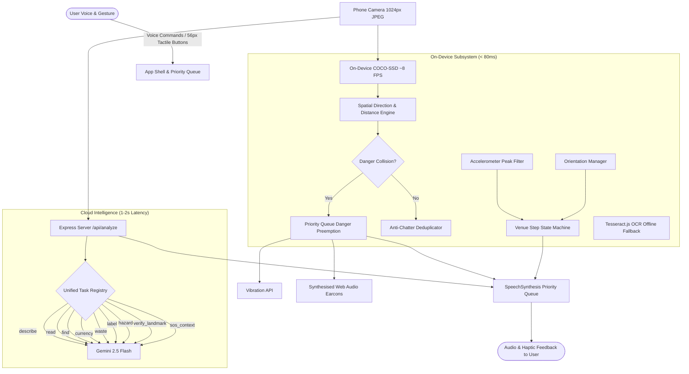

# SightLine 👁️🔊

> **Voice-First AI Environmental Awareness & Spatial Navigation Assistant for the Visually Impaired**  
> *Built for HackAttack 2026 (AMC Engineering College) — Track: Sustainability & Social Impact.*

SightLine is an accessible Progressive Web App (PWA) that transforms any standard smartphone into a continuous spatial guide. By fusing low-latency on-device computer vision with Google Gemini 2.5 Flash cloud intelligence, SightLine translates the physical world into clear, directional speech, synthesised earcons, and urgent haptic alerts.

---

## 🌟 Key Features

| Mode | Capability | Tech / Latency | Audio & Spoken Cue |
| :--- | :--- | :--- | :--- |
| **Around Me** | Real-time object awareness in 5 spatial sectors | On-device COCO-SSD (~8 FPS, <80ms) | *"Chair slightly-left, near."* |
| **Obstacle Alert** | Collision warnings with central corridor & size-growth tracking | On-device COCO-SSD + Haptics | Accelerating proximity beeps + *"Stop. Table ahead, close."* |
| **Read Signs** | Directional OCR fusing printed text and directional arrows | Gemini VLM (Tesseract.js offline) | *"Exit, arrow points right."* |
| **Find Destination** | Destination finder with HRTF 3D audio beacon | State machine + Web Audio PannerNode | Earcon chime + spatial ping panned to ear |
| **Venue Navigation** | Turn-by-turn indoor guidance with step & compass dead reckoning | Pre-mapped JSON + Accelerometer | *"Walk about 20 steps. Turn left at corridor."* |
| **Currency Reader** | Identifies Indian Rupee banknotes (₹10–₹2000) | Gemini VLM (Zero-guess fallback) | *"Five hundred rupee note."* |
| **Waste Sorter** | Classifies wet, dry, recyclable, hazardous, e-waste + bin color | Configurable `waste-map.json` | Success chime + *"Plastic bottle. Dry waste, blue bin."* |
| **Label Reader** | Reads product packaging, allergens first, strictly no guessing | Zero-guess safety rules | *"Allergens: Peanuts. Please verify medicine with a person."* |
| **Hazard Scan** | Best-effort periodic scan for stairs, drop-offs, and open drains | 6s rate-limited cloud scan | Danger alert + *"Caution: stairs ahead."* |
| **Emergency SOS** | Instant GPS coords + visual surroundings context | Geolocation + Visual context | Prefilled WhatsApp / SMS dispatch |

---

## 🏗️ Architecture



---

## 🔒 Privacy & Safety Directives

1. **Zero Persistent Storage:** Camera frames are processed strictly in ephemeral memory and discarded immediately. No images are saved to `localStorage`, `IndexedDB`, or written to cloud disk.
2. **No Biometric Tracking:** SightLine explicitly disallows face identification, person tracking, or biometric logging.
3. **Honest Uncertainty:** SightLine refuses to guess on blurry currency notes, faint labels, or unconfirmed checkpoints (*"I'm not sure"* rather than hallucinating).
4. **Primary Mobility Disclaimer:** SightLine is an environmental awareness aid; it does **NOT** replace a white cane or guide dog.

---

## 🚀 Quickstart & Setup

### Prerequisites
- Node.js 20+
- npm 10+
- Google Gemini API key ([Google AI Studio](https://aistudio.google.com/))

### 1. Clone & Install
```bash
git clone https://github.com/ani18cs/hack-attack.git
cd hack-attack
npm ci
```

### 2. Configure Environment
```bash
# Server configuration
cp server/.env.example server/.env
# Edit server/.env: GEMINI_API_KEY=your_key_here

# Client configuration
cp web/.env.example web/.env
```

### 3. Run Development Servers
```bash
# Starts both web (port 5173) and server (port 8787)
npm run dev
```

### 4. Validate & Test
```bash
# Run 100% of monorepo unit tests (41 web + 18 server tests)
npm test

# Validate the AMC Engineering College venue pack
npm run venue:validate --workspace=web

# Verify production build
npm run build
```

---

## 📱 Mobile HTTPS Testing (Zero-Setup)

Mobile cameras and sensors require a secure HTTPS context. Expose your local port via Cloudflare Tunnel:
```bash
# Launch Cloudflare tunnel on web port
cloudflared tunnel --url http://localhost:5173
```
Open the generated HTTPS URL on your Android/iOS smartphone, tap the giant yellow button to unlock camera and audio permissions in a single gesture, and begin!

---

## 📚 Documentation Index

- [📖 Honest Limitations & Safety Posture](docs/LIMITATIONS.md)
- [🎬 4-Minute Hero Demo Script & Judge Q&A Playbook](docs/DEMO_SCRIPT.md)
- [🚶 AMC Engineering College Venue Walk Survey Protocol](docs/VENUE_WALK.md)
- [🧠 Single Source of Truth Knowledge Base](docs/KNOWLEDGE_BASE.md)
- [👥 Role A (App & A11y) Guide](docs/TEAM_MEMBER_A_APP_A11Y.md)
- [👥 Role B (Vision & Spatial) Guide](docs/TEAM_MEMBER_B_VISION.md)
- [👥 Role C (AI & Server) Guide](docs/TEAM_MEMBER_C_AI_SERVER.md)

---

## 🏆 Hackathon Details
- **Event:** HackAttack 2026, AMC Engineering College (Autonomous), Bengaluru
- **Track:** Sustainability & Social Impact
- **Team:** Aniket Kumar Singh (Lead), Role B Lead, Role C Lead
